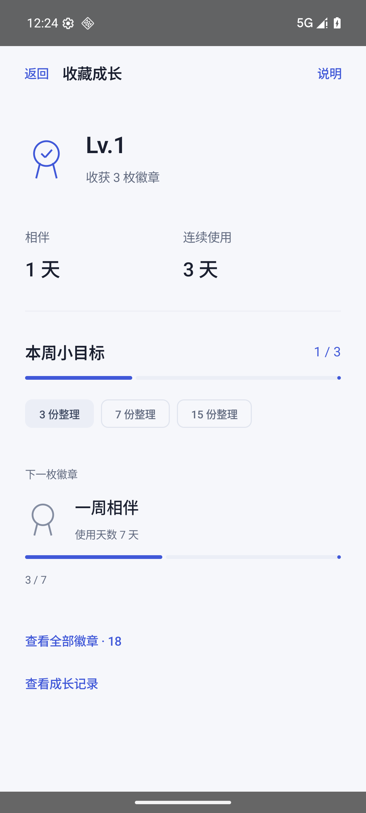

# v0.11 更轻松的界面

成长首页减少数字和解释，使用记录按需展开；不更改档案、照片和播放器逻辑。

35 JVM和成长原生场景通过；周目标、徽章重开保持，最近任务选项通过。正式同签名包安装启动通过；其他媒体/分享回归沿用v0.10的未变代码证据。

正式APK SHA256：`4ab5fe2d9a8938f4723c107c75d429b393ede1c90a13189136fcbf0140cc85e0`。截图来自匿名测试数据。实体手机未连接，未声称用户认可审美或真机已经更新。原签名、包名和业务数据格式保持；回退使用后续递增版本。

