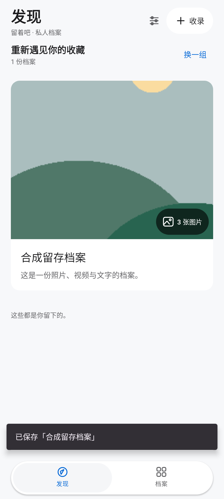
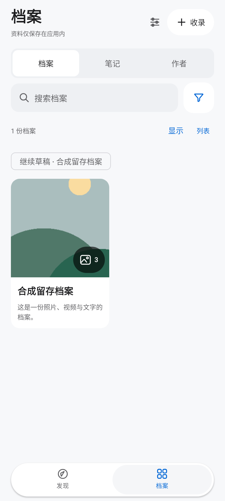
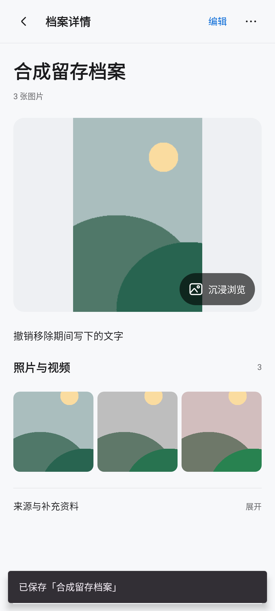
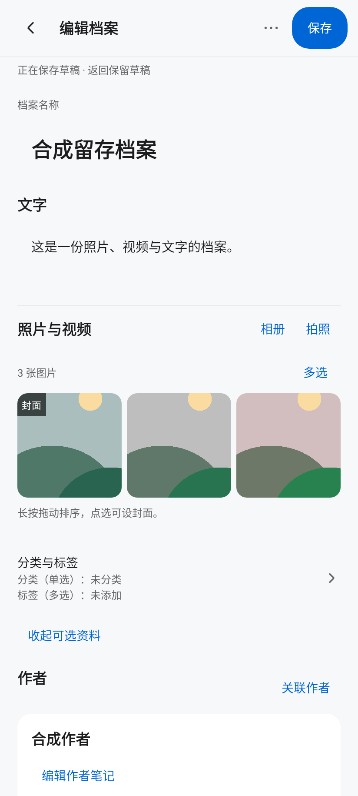

# 0.18界面与流程证据

此目录为实际Kotlin/Compose实现的API35 Robolectric原生图形宿主渲染，合成几何图片/文字，不含私人资料。静态截图不能证明动画、真实视频编解码或手机手感，也不代表用户已认可外观。

| 发现 | 档案 |
| --- | --- |
|  |  |
| 阅读 | 编辑 |
|  |  |

- [发现](product-discovery.png)、[档案](product-library.png)、[阅读](product-reading.png)、[编辑](product-editing.png)
- [深色200%发现](product-discovery-dark-font200.png)、[深色200%详情](product-detail-dark-font200.png)
- [空库](product-discovery-empty.png)、[缺失原件](product-missing-original.png)

文件摘要在screens.json。截图中的保存提示/草稿来自真实测试操作，不是宣传图。源码与实际检查以PR39当前提交、HANDOFF及Actions精确SHA为准；最终全量、原生模拟器和正式覆盖升级单独记录，未完成不写通过。

## 最终发行验收

[0.18正式安装包](https://github.com/h516df/liuzheba/releases/tag/v0.18)已发布。正式源码`fcd10904f9e169753c116773788fe22f79e14bd0`，宿主300/300、59 suites，API35原生8/8，原证书真实0.16→0.18覆盖升级和三资产匿名下载校验通过；实体手机未验。完整来源、ZIP摘要、APK摘要和边界见[delivery.json](delivery.json)。这次后续只补充文档，应用源码与正式发行保持一致。
