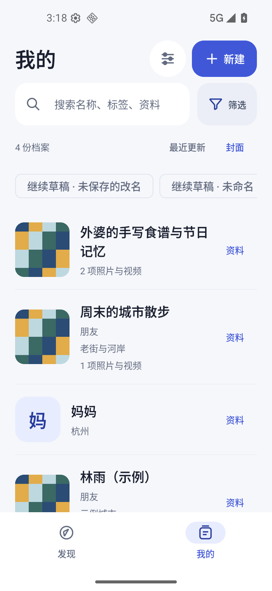
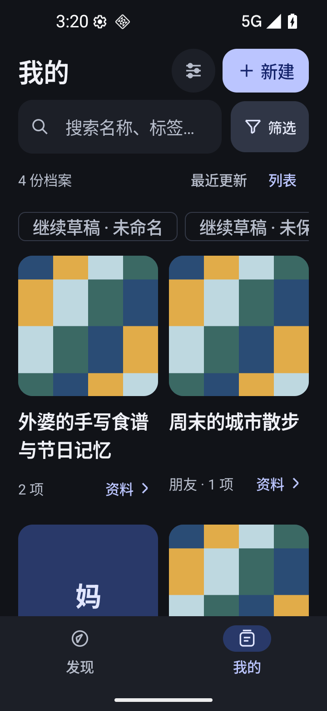
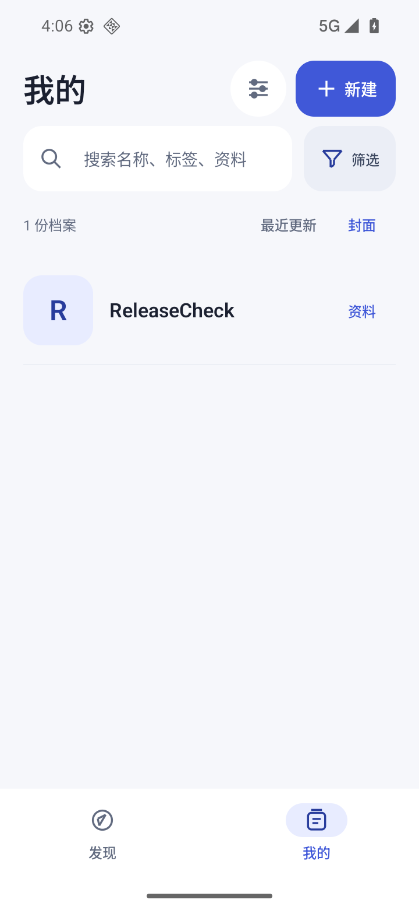

# v0.7 验证记录

本次延续发现 / 我的双入口，调整封面、文字和列表层级。资料结构、媒体、备份和更新协议不变。

- `testDebugUnitTest assembleRelease lintRelease` 通过，23 个 JVM 测试通过。
- 界面提交 `037ec7ce9228e96e819cd1815f332b633951329a` 的隔离 `.verification` 原生测试通过：浅色及深色 1.3 倍字号，空库、密集封面/列表、搜索、无照片档案、详情与编辑。升级版本只变更版本、说明及网络测试前置版本，沿用上述界面实现；代表截图见本目录。
- 正式 `dev.h516.shicang` 0.6 → 0.7 覆盖安装通过；升级前用真实界面创建合成档案 ReleaseCheck，升级后列表和详情仍可读取。没有卸载或清数据。
- 环境：自有隔离 AVD WalkPaint_Google_API36_V044、Android 16/API 36、x86_64，720 × 1560、320 dpi。正式 APK 不可调试，code 8，原签名一致。
- APK SHA256：`22e158a1620e1e465e5d011c95c75dae0904e845c9ff038836895320c71766a6`。
- 证书 SHA256：`67127caf5a760d51f11dc5a2fadcf44ddc30ce836fa14ffb9efd96c4b7e95a26`。

这是模拟器与发布包证据，用户实体手机上的安装、操作和数据尚未验收。若发现问题保留当前数据，使用递增版本修复；不要卸载旧版或尝试降级数据库。

