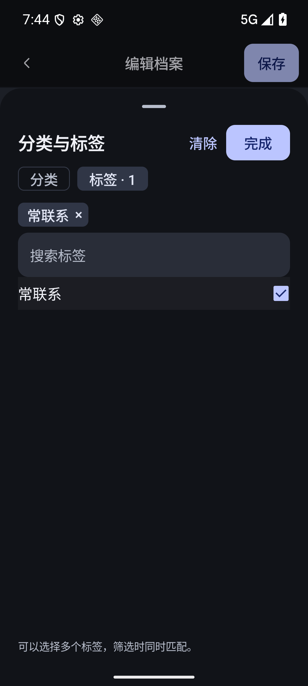
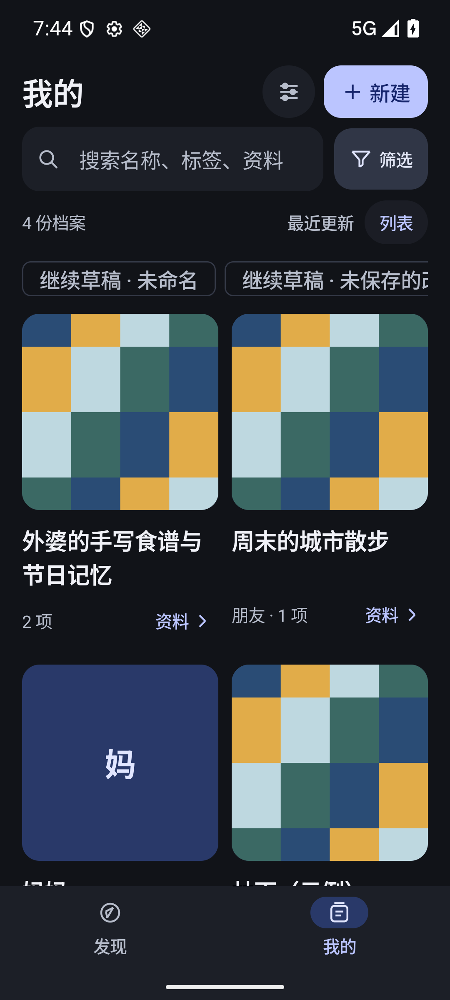
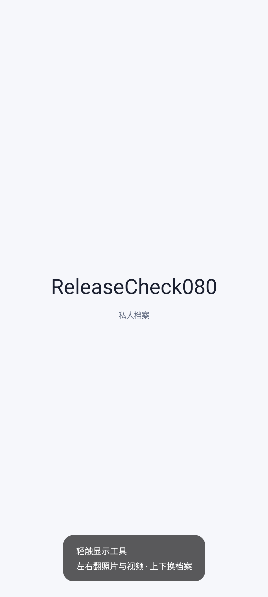

# v0.8 验证记录

视频沿用 Media3，增加倍速、静音、收起及继续播放；后台暂停、返回和收起保留进度与播放状态。标签选择区展示已选标签，可直接移除；创建失败保留输入并允许重试，保存后重新打开及搜索核对实际资料。

- 24 个 JVM 测试、正式构建及 lintRelease 通过。隔离 `.verification` 的 VideoUiTest、DesignV19Test、StoreTest、ViewerLockTest、BackupPrivacyTest 共 11 个原生测试通过；另有曜石主题、1.3 倍字号的完整 DesignV19Test 通过。
- 视频回归使用真实播放器：暂停并定位到 1 秒、后台返回位置误差不超过 150 毫秒、倍速、静音、收起与继续；标签回归包含创建、移除、重新选中、保存、重开及结果搜索。
- 正式包 0.7/code8 → 0.8/code9 同签名覆盖成功。旧版通过界面建立的合成档案 ReleaseCheck080 升级后仍可读取，没有卸载或清库。
- 环境为本任务独占的只读 AVD WalkPaint_Google_API36_V044，Android 16/API36，x86_64。截图为合成资料；正式包不可调试。
- APK SHA256：`00f1d5fdf332aa94b5a635933e16ff736b5f316242635cf7556be90fcf0443ff`。

实体手机、用户原视频格式与长时间播放尚未验收。数据库和备份格式未变；回退应采用同签名、递增版本的修复包，保留资料，不能卸载清库。公开发布待授权；本地正式包已经准备。

