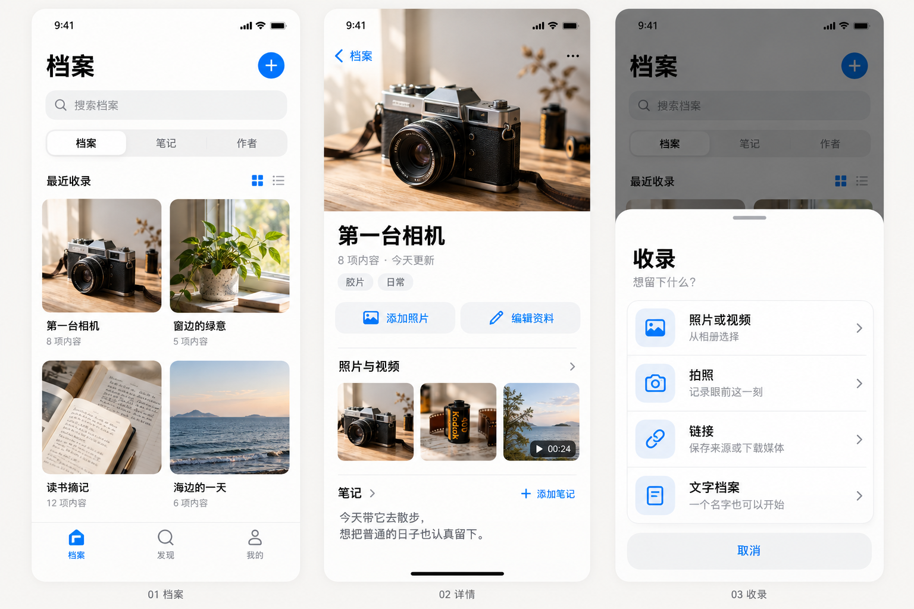

# 留着吧：体验重构准备

日期：2026-10-21。状态：研究与实施建议，尚未修改产品行为，未做本轮原生或实体手机验收。

## 目标与判断

用户反馈“现在体验糟糕”，要求为重构准备、查看网上灵感。建议把留着吧收拢为一个容易收录、浏览和找回的本地私人档案库。优先验收完整操作路径，再决定外观细节；更换颜色、卡片和名称不足以证明体验改善。

用户已明确最痛的是“整体布局混乱、功能难找”。因此首批围绕信息层级、入口可发现性和功能归位准备，性能优化作为基础支撑。以下具体布局是代理建议，不是用户已确认的设计；不把未经计时的代码分析写成手机性能结论。

## 先看 UI：第一版视觉方向

用户补充：整体 UI/UX 不像正常能使用的 App，喜欢苹果，要求先做 UI 看效果。本轮因此先提供档案首页、详情与收录面板三屏设计预览，后续先根据视觉反馈迭代，再进入原生实现。



这是生成的视觉概念，图片内容为虚构示例，并非真实 Android 截图或可点击原型。图中 iPhone 风格系统栏仅表达视觉参考；正式实现继续使用 Android 的系统栏、返回、权限和文件选择器行为，不迁移为 iOS 项目。

- 档案：首页只留标题与收录主动作，搜索及“档案/笔记/作者”文字索引，统一的内容网格。
- 详情：媒体、名称、标签、添加/编辑动作、照片视频与笔记分层，避免把全部字段堆成表单。
- 收录：底部面板用四个文字动作说明照片/视频、拍照、链接、文字档案；不再要求用户猜图标含义。
- 视觉：浅底、黑字、少量蓝色动作、统一圆角与细分隔；内容负责主要色彩。三屏之外的发现与我的尚未出本轮视觉稿。

## 基线与已有工作

- 主线：[`a9854163e4746a1285eadf799bdb3022b2370722`](https://github.com/h516df/liuzheba/commit/a9854163e4746a1285eadf799bdb3022b2370722)，已用 `git ls-remote` 与本地 HEAD 核对。
- 当前源码版本为 0.16 / code17；本轮 `gh release list` 读到最新正式版 v0.16。当前没有发布新版本，也不预占下一个版本号。
- [PR #28](https://github.com/h516df/liuzheba/pull/28) 仍是 open / draft，head 为 `031d816e752bf26e6ab13ac63dc4579f91b6877e`，提供标签优先、直接追加媒体和存储响应改进。它是第一批可复用候选，不能当成已上线，也不要重新写一遍。
- GitHub 元数据本轮返回 `mergeable: false`，但本地 `git merge-tree --write-tree origin/main origin/feat/core-journey-20261020` 成功，候选树为 `e0ae6a1f4af0072dd8a6d8b32a7183991f1b539f`。两种观察不一致；实施前重新核对 GitHub 和实际合并树，不能直接宣布有冲突或可发布。该命令没有合并分支或改变工作区。
- 主线已有 `VideoEditorUi`、`LongNotesUi`、`DiscoveryPreview` 和 [统一入口说明](../unified-navigation.md)。原 PR #24/#25/#26 的 head 并不是当前 main 的祖先，不能靠 ancestry 或“PR 还开着”判断功能缺失；需逐文件与行为核对，避免再次引入同一功能。

本轮方案单独保存在 `codex/experience-refactor-prep-20261021`。不合并、关闭或改写其他任务分支。

## 当前体验问题：事实与待验假设

代码证据链接固定到上述主线；这些是静态观察，不能替代真实操作录像和计时。

| 路径 | 已确认的代码事实 | 体验判断及验证方法 | 已有候选 |
| --- | --- | --- | --- |
| 找入口 | [Ui.kt](https://github.com/h516df/liuzheba/blob/a9854163e4746a1285eadf799bdb3022b2370722/app/src/main/java/dev/h516/shicang/Ui.kt#L188) 的“导入与作者”图标菜单同时包含全部笔记、作者卡和链接下载 | 菜单名称难以预测内容。让首次使用者分别找到这三项，记录误点与退回次数 | #28 不解决完整入口组织 |
| 向已有档案追加媒体 | [详情路由](https://github.com/h516df/liuzheba/blob/a9854163e4746a1285eadf799bdb3022b2370722/app/src/main/java/dev/h516/shicang/Ui.kt#L249) 调用 `model.edit(a); choosePhotos(a.id)`；[importPhotos](https://github.com/h516df/liuzheba/blob/a9854163e4746a1285eadf799bdb3022b2370722/app/src/main/java/dev/h516/shicang/AppModel.kt#L239) 写入草稿 | 单一追加意图被带进整份档案编辑；需检查用户是否知道还要保存，以及返回后新增媒体是否落盘 | #28 已提供直接追加候选，应复用其原子提交边界 |
| 日常浏览被管理信息打断 | [主界面](https://github.com/h516df/liuzheba/blob/a9854163e4746a1285eadf799bdb3022b2370722/app/src/main/java/dev/h516/shicang/Ui.kt#L199) 可依次显示更新提醒、版本提示、保护提示；正常待保护也会出现 | 顶部内容高度变化可能挤压首屏。验空库、首次启动、正常使用、故障四种状态，不删除风险提示换取简洁 | #28 已区分需要处理与正常保护状态 |
| 操作时其他功能受限 | [AppModel.work](https://github.com/h516df/liuzheba/blob/a9854163e4746a1285eadf799bdb3022b2370722/app/src/main/java/dev/h516/shicang/AppModel.kt#L207) 使用单个 `busy`，成功和 finally 都调用 `reload()`；草稿更新也会 reload | 可能出现不必要等待和整库刷新；需分别测导入、普通编辑、自动保护，不把后台工作一律并发化 | #28 减少重复读取，但大媒体导入仍有忙碌边界 |
| 自动保护与交互竞争 | [Store.protectNow](https://github.com/h516df/liuzheba/blob/a9854163e4746a1285eadf799bdb3022b2370722/app/src/main/java/dev/h516/shicang/Store.kt#L94) 在数据库 gate 内生成资料并调用保护读回 | 保护期间可能阻塞其他同锁操作；实际程度取决于原件规模和 provider，应做故障注入和实机计时 | #28 已有快照、独立锁及修订号方案，不重造 |
| 找回内容 | [LibraryV19](https://github.com/h516df/liuzheba/blob/a9854163e4746a1285eadf799bdb3022b2370722/app/src/main/java/dev/h516/shicang/DesignV19.kt#L68) 已有搜索、分类、标签、排序、列表/封面和高级选项，但常用筛选没有直接复用入口 | 频繁查同一组资料时可能重复设置。先验证最近标签是否足够，再决定是否增加保存视图 | #28 做标签优先，未实现完整保存视图 |
| 浏览与返回 | [Ui.kt](https://github.com/h516df/liuzheba/blob/a9854163e4746a1285eadf799bdb3022b2370722/app/src/main/java/dev/h516/shicang/Ui.kt#L81) 通过字符串路由、多组返回变量、媒体位置及弹层状态共同调度 | 状态组合多是维护风险，不是已证实返回错误；应验搜索→全屏→详情→编辑→返回全过程 | 保留已有状态与播放器回归，不整体替换 Pager |

当前实际档案入口使用 `LibraryV19`，详情使用 `DetailV19`。`Ui.kt` 中旧 `LibraryScreen` / `Detail` 定义不能当成当前界面依据；整理旧代码前先确认调用点。

## 网上参考与取舍

2026-10-21 使用 Firecrawl 搜索，并阅读全文页。以下依据是官方产品说明，不是已在本轮实际操作过这些 App。

| 来源 | 核实到的交互 | 适合留着吧的做法 | 不直接引入的部分与成本 |
| --- | --- | --- | --- |
| [Eagle：Tags](https://en.eagle.cool/support/article/tags) | 同一输入框搜索已有标签/创建标签；最近使用、常用标签；已添加状态明确 | 收录时可直接点最近标签；编辑与批量整理共用标签选择器。已有 #28 优先复用 | Eagle 为商业产品，不复制界面资产或代码。不要照搬桌面悬浮窗、快捷键与多层标签配置；成本低至中 |
| [mymind：Spaces](https://mymind.helpscoutdocs.com/article/46-how-to-use-spaces) | 普通空间手动收集，智能空间保存搜索条件并随匹配项更新 | 后续允许“把这次筛选保存为视图”；先用文字、标签、时间这些本机确定性条件 | 不引入其云端 AI/图片识别，不宣称已有自动理解能力。保存视图涉及持久化和备份策略，成本中，排在基本流程之后 |
| [Anytype：Collections](https://doc.anytype.io/anytype/organize/collections) | 对象独立于集合；同一对象可属于多个集合；移出集合不删除对象；手动集合与规则查询区分 | 档案是稳定主体，照片/视频/笔记围绕档案；“取消标签”和“删除档案”保持明确区别 | 本轮不增加独立集合实体，不引入其对象图、协作或整套属性系统。若未来复制代码，必须另查具体文件许可；本次仅借鉴行为 |
| [Ente：Albums and Organization](https://ente.com/help/photos/faq/albums-and-organization) | 相册编辑放在更多菜单；未分类承接无相册内容；幻灯片控件按需显示；删除与保留照片有不同语义 | 管理动作按上下文出现；无标签档案仍能找回；看图时控件可收起，资料按需展开 | 不是迁移 Ente 的服务器或同步。该页幻灯片只含照片/Live Photos，不含视频；留着吧混合媒体仍由已有 Media3/Telephoto 实现 |

许可证策略：本次未复制第三方源码或产品截图；视觉预览由图像工具生成，未采用抓取的品牌资产。商业产品说明仅作行为参考；官方帮助页不能证明某段代码可按 Apache-2.0 使用。新增实现继续用已有 Kotlin、Compose、SQLite、Coil、Media3、Telephoto，若将来需要外部代码，先查具体仓库和文件许可。

## 建议的信息组织

保留现有三个顶级入口，减少再次学习导航的成本。名称“发现 / 档案 / 我的”先保持；“我的”明确承担应用管理，不额外制造个人主页。

```text
档案（默认）                 发现                     我的
  内容索引：档案 / 笔记 / 作者  全幅照片或视频             资料安全与存储
  搜索当前索引                上下切档案，左右切媒体     标签与模板管理
  档案内容墙 / 列表           轻触显示控件               外观 / 隐私 / 更新
  收录：照片、拍照、链接、文字  资料按需展开               成长记录降为次级入口

档案详情
  标题与已有资料
  媒体：查看 / 直接添加
  笔记：阅读 / 明确编辑
  作者与来源：按关联显示
  修改整份资料：独立入口
```

这是文字层级草图，不是原生渲染或已完成的设计稿。

- **内容入口直接可见**：建议档案区顶部给出“档案 / 笔记 / 作者”文字索引，切换改变当前内容和搜索范围，不再用一个含义模糊的图标承载三种内容。它们是同一目的地下的内容索引，不新增全局底栏；先用原生小样验证两层导航是否清楚。
- **首页控制密度**：标题行只保留“收录”主动作；下方是内容索引、搜索和内容。排序/封面模式进带文字的显示菜单；高级搜索只在用户请求时展开。最近标签与继续草稿仅在适用时出现，不能又堆出多排工具栏。严重保护故障保留可见提示，普通状态放到我的。
- **收录**是动作：把本机照片/视频、拍照、链接、文字集中在可读名称的入口；“链接”内再分保存来源/尝试下载，失败仍能保留输入。先原型验证，不能把尚未落盘的下载当作已收录。
- **笔记**是内容：档案内的笔记留在详情；全部笔记从文字索引进入，不混在“导入与作者”图标里，不藏进应用设置。
- **作者**是关联：详情能查看或选择关联作者，全部作者从文字索引进入；主页链接识别失败仍允许手工保存。创建或导入作者在作者索引提供明确动作，不与作品下载合并。
- **保存**有明确语义：新建允许只有名称；追加原件完成后直接反馈数量；改整份资料仍使用草稿/保存/放弃；部分导入失败明确说明哪些未收录。
- **资料安全**平时显示简洁状态，失败、权限和空间问题优先可见；恢复、永久删除及未加密备份的必要确认保留。

## 四条目标路径

动作预算为新方案目标，尚未实测；不计系统授权、选择照片数量和输入文字。不得删掉必要确认凑步数。

1. **给已有档案加照片**：详情“添加”→系统选择→完成后自动返回原档案并显示已收录数量。目标：选择器以外不再进入整份编辑或二次点保存。失败留在原位置并保留原档案。
2. **先记一个名字**：收录“文字/档案”→名称→保存。分类、标签、作者、自定义字段均可后补；保存失败不丢输入，返回按已有草稿约定处理。
3. **看完继续找**：搜索/标签筛选→媒体全屏→查看资料→返回。筛选、列表位置和当前媒体均保持；进入编辑、弹层或后台时停播，取消后不意外自动播放。
4. **把收录内容找回来**：最近标签或搜索→结果。零结果给出清除筛选；无媒体/未打标签的档案不能消失。保存视图只在确认重复筛选需求后增加。

## 实施顺序和退出条件

| 批次 | 工作与预期交付 | 退出条件 |
| --- | --- | --- |
| P0：建立入口基线 | 在 main 与 #28 合成候选上清点功能入口；首次使用者找收录、笔记、作者、资料安全，记录误点/返回；再走四条路径，记录设备/主题/字号和落盘结果 | 形成入口归属表和问题清单，逐项标明 main 已有、候选已修、仍未解决。历史测试仅作线索 |
| P1：先收拢布局与入口 | 首先做档案内容索引、收录面板和我的分组的原生小样；保留现有数据能力，明确详情/全屏/编辑的层级 | 不经口头提示能找到四类功能；在空库/已有资料/200% 字号/明暗中可辨认、可点击；使用者知道当前位置和返回去向 |
| P2：整合与打通 | 独立审查并复用 #28 的直接追加、标签优先、保护调度及重复读取修复；把入口小样接到现有真实流程 | 同一最终树的四条路径、逻辑/UI、备份/恢复、取消边界与相关性能检查通过；新增媒体重开仍在，取消编辑不提交其他字段；旧 head 结果不能证明新合并树 |
| P3：降低维护耦合 | 把 AppShell/导航返回状态、收录流程、档案页、查看器状态分开；按读写职责拆 AppModel，Store 的资料与保护事务边界保持清楚 | 每次只迁移一个流程，行为回归通过。先消除重复执行和状态组合，再按真实瓶颈决定数据库查询或分页；不直接重写存储格式 |
| P4：可选增强 | 最近使用标签进一步完善；有重复使用证据后再做保存视图 | 定义视图是否进备份、关联删除行为及旧版兼容，再单独提交。与基础重构分开验收 |

不建议一次重写整 App。首批无需引入新框架或新数据库；代码文件拆分不能作为用户体验改善的验收证据。

## 验收方法

实施期间继续使用 [云端检查入口](../../cloud/check.sh) 与独立 `.verification` 包，只使用合成文字、色块与测试视频。

- 功能：四条目标路径，新增保存/重开、追加部分失败、取消、搜索返回、长按选择/系统返回、编辑弹层停播。
- 资料：媒体原件哈希、草稿隔离、作者和笔记关联、旧备份读取、保护/恢复/撤销、恢复代际变化后旧编辑会话禁止写入。
- 原生显示：空库、长名称、无照片档案、320dp 窄屏、200% 字号、明暗、真实键盘遮挡和 TalkBack 操作名称。
- 可发现性：让未看说明的使用者找“收录照片、全部笔记、作者资料、备份恢复”，记录首次点击、绕行和是否需要提示。目标是四项都能在自己的明确入口找到，不以按钮变少或审美主观评分代替。
- 响应：合成 1000 档案与多媒体样本，在固定设备重复测冷/热启动、追加、标签编辑、返回。分开记录主线程卡顿、存储等待与图片加载，不拿宿主微基准倍数宣称手机提速。
- 设备：真实录屏方向/音轨/编辑导出、文件选择器撤权/取消/空间不足；正式原证书旧版→新版覆盖升级及资料保留另验。

本轮状态：源码事实/远端分支/外部来源已核对；业务测试、APK 构建、原生运行、实体手机及正式发布均 **not run**。完整检查命令准备为：

```bash
source .cloud/env.sh
bash cloud/check.sh
```

本轮仅研究文档与视觉概念资产变更，不用运行整套业务构建来证明研究或概念成立。真正修改产品后必须按上述范围验证。

## GitHub 交付能力

本轮 GitHub 连接返回仓库 admin/push 权限，云端 `gh api user` 与仓库元数据读取成功，`gh release list` 可读发行记录。因此可以在已有仓库推送独立分支、建立 PR，并通过已认证 CLI 执行 Release 工作流；本轮会用实际分支推送验证源码写入，而不是创建一个空 Release 测权限。用户此次问的是能力，未要求立即发版。

当前云端未配置原正式签名。创建 GitHub Release 与交付官方 APK 是不同步骤：后者必须按 [发布约定](../RELEASING.md) 注入 `SHICANG_SIGNING_PROPERTIES` / `SHICANG_KEYSTORE`，同签名且 versionCode 递增，绑定最终源码和校验值；未经这些检查不能发布 unsigned/debug 包冒充官方版本。

## 下一步

当前先向用户展示上面的 UI 视觉稿，等待视觉方向反馈，不把稿件当成已认可方案或已完成产品。之后做 P0 入口清点与 P1 原生小样，围绕“整体布局混乱、功能难找”验收。对照 main 与 #28 的四条路径，已有工作先核对再复用。方案、视觉稿和本轮交接一起推送，下一会话从对应 PR 读取，不只读 main。
