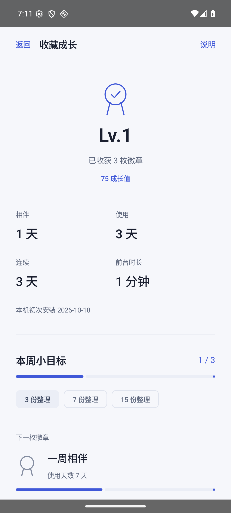
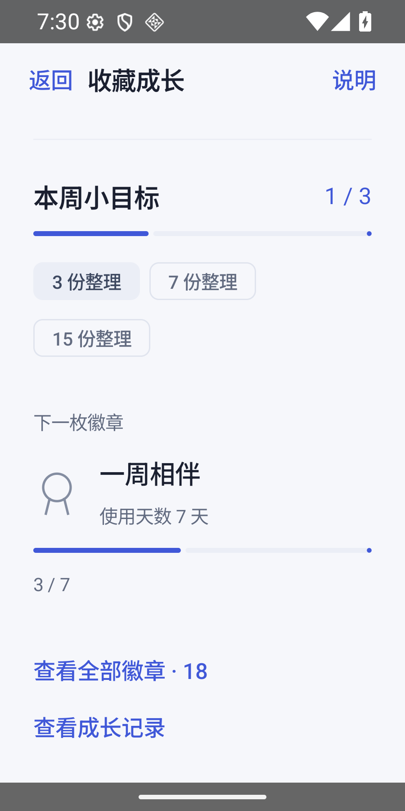
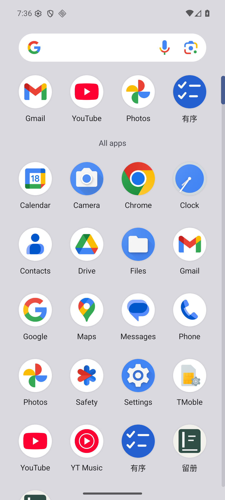
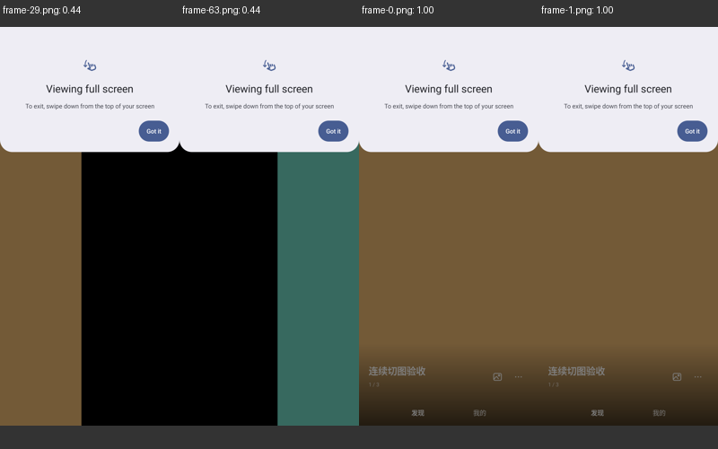

# 留册 0.10 验证

拾藏更新为留册：仅显示名、图标与品牌文案改变；包名 dev.h516.shicang、正式签名、更新前缀和资料格式不变。当前 Codex 为唯一实现和整合负责人。

- 35 项 JVM 测试通过。
- Android36 x86_64 专用AVD中，完整原生套件14场景通过；另1项显式联网更新用例按设计跳过。包括照片切换、视频手势、锁定、分享、左滑恢复、资料与备份、成长目标和徽章、最近任务开关。
- 大字体1.3、900×1800视口下成长目标、日历和最近任务路径再次通过，选项自然换行。
- 旧切图实现69个采样帧中最低可见比例0.435；修复后同样69帧均1.0。保持页面图像组件和解码状态，预加载相邻页，去除切图淡入；离散采样不代表所有真机帧。
- 最终正式包在AVD从v0.9覆盖升级至v0.10，升级前创建的 Upgrade-proof-0910 档案仍可见；名称显示留册，签名67127caf5a760d51f11dc5a2fadcf44ddc30ce836fa14ffb9efd96c4b7e95a26保持一致。
- 最后图标资源修正补齐Android24/25回退、Android33单色图标；正式包在Android36桌面和升级路径检查，API24/25未运行设备验收。

最终APK SHA256：33fc264682f0415116f35323c0745e21000b6bf48cc011756a86e091eb1533ec

截图均为匿名测试内容。需求审查：减少文字与铺满卡片，成就按真实档案/资料计算，徽章ID稳定不重复授予。工程审查：不迁移原数据、不换签名、不增加后台心跳或权限；只保留相邻页，锁定和视频回归通过。成长统计只存本机，不随业务备份迁移。实体手机、用户原照片/视频和真实三平台分享仍未验收。兼容回退需同签名更高版本号。
